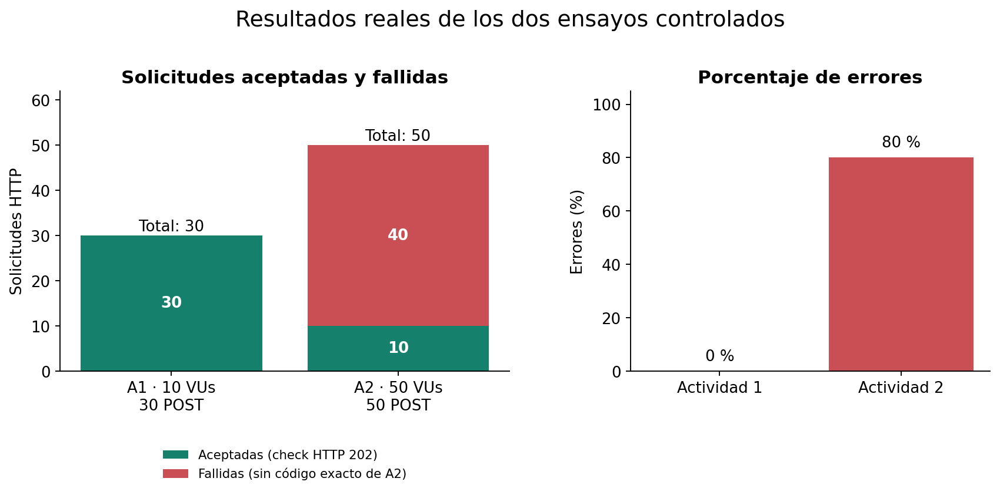

# apiusuarios — Algoritmos Paralelos: pruebas de carga con k6 y AWS

Práctica universitaria de **Pruebas de Carga y Análisis de Rendimiento** sobre
un backend Spring Boot/Java 21. Se estudia el flujo API Gateway → Lambda Java →
SNS → SQS → Lambda Python → SES mediante solicitudes `POST /notifications/send`.

**[Leer el informe definitivo en PDF](pruebas-carga/informe/Informe%20De%20Pruebas%20Paralelo%201-21-2841.pdf)**.
El PDF se conserva tal como fue entregado; los archivos Markdown y gráficos son
material de apoyo. Repositorio existente:
[ErickManu/apiusuarios-serverless](https://github.com/ErickManu/apiusuarios-serverless).

La cuota regional confirmada es de **10 ejecuciones Lambda simultáneas**.
No se ha solicitado una ampliación para esta práctica.

## Entrega técnica

- [Informe con resultados reales](pruebas-carga/informe/INFORME-TECNICO.md).
- [Resumen visual HTML, para abrir localmente](pruebas-carga/informe/RESUMEN-VISUAL.html).
- [Actividad 4: análisis de degradación](pruebas-carga/informe/ACTIVIDAD4-DEGRADACION.md).
- [Actividad 5: recuperación histórica](pruebas-carga/informe/ACTIVIDAD5-RECUPERACION.md).
- [Índice de evidencias y procedencia](pruebas-carga/evidencias/README.md).
- [Escenarios de 100, 250 y 500 VUs, pendientes y bloqueados](pruebas-carga/pendientes/README.md).
- [Preparación de la entrega en GitHub](docs/ENTREGA-GITHUB.md).
- [Inventario y revisión previa a publicar](docs/REVISION-PUBLICACION.md).

La Actividad 1 produjo 30 respuestas aceptadas y 0 % de errores. La Actividad 2
produjo 10 aceptadas y 40 fallidas de 50 solicitudes. CloudWatch confirmó al
usuario 40 throttles y concurrencia máxima de 10. El PDF contiene capturas de
CloudWatch y consola; faltan exportaciones históricas independientes para un
análisis temporal. No se conocen los códigos HTTP exactos de las 40 fallidas.

Los ensayos fueron controlados: tenían un presupuesto finito de POST y no
mantuvieron tráfico sostenido durante todo el tiempo configurado. Los escenarios
pendientes no tienen resultados. No se realizó un estrés incremental completo.
El tiempo de recuperación real está pendiente por falta de series temporales.

## Resultados medidos

Datos extraídos de los resúmenes originales de
[Actividad 1](pruebas-carga/evidencias/actividad1-20261016-005817.json) y
[Actividad 2](pruebas-carga/evidencias/actividad2-50vus-20261016-014407.json).

| Indicador | Actividad 1 | Actividad 2: escenario 1 |
| --- | ---: | ---: |
| VUs / duración configurada | 10 / 1 minuto | 50 / 2 minutos |
| Solicitudes HTTP | 30 | 50 |
| Aceptadas (check HTTP 202) / fallidas | 30 / 0 | 10 / 40 |
| Errores | 0 % | 80 % |
| Latencia promedio (ms) | 8587,79 | 5127,91 |
| Mínima / máxima (ms) | 94,54 / 26885,33 | 75,15 / 26459,00 |
| P95 / P99 (ms) | 26538,44 / 26876,78 | 25687,66 / 26104,94 |
| Promedio de aceptadas (ms) | 8587,79 | 25295,21 |
| Throughput global (POST/s) | 0,4337 | 0,4136 |

La media global de A2 baja porque incluye fallos rápidos: las aceptadas tardaron
unos 25,30 segundos de promedio. El throughput incluye las esperas del escenario
y sus intentos fallidos; no representa capacidad máxima ni tráfico sostenido.
Los presupuestos y duraciones son diferentes, por lo que la tabla no demuestra
una mejora de rendimiento. P95/P99 describen estas muestras pequeñas.



El cuello de botella observado fue la cuota concurrente de Lambda: la ráfaga de
50 coincidió con 40 throttles y un máximo de 10 ejecuciones. Los arranques en frío
de Spring Boot también prolongaron respuestas aceptadas. Las mejoras propuestas
son distribuir solicitudes en el tiempo, dejar capacidad para la consumidora y
medir la inicialización de Spring/JPA/Neon antes de aumentar usuarios. No se
aplicaron cambios a AWS para esta entrega. HTTP 202 acredita aceptación; la
finalización asíncrona se revisa por separado en SNS, SQS, Lambda y SES.

## Escenarios pendientes: no ejecutados

| Escenario | Duración prevista | Estado | Resultados |
| --- | --- | --- | --- |
| [100 VUs](pruebas-carga/pendientes/actividad2-100vus.js) | 2 minutos | NO EJECUTADO / BLOQUEADO | Sin mediciones |
| [250 VUs](pruebas-carga/pendientes/actividad2-250vus.js) | 2 minutos | NO EJECUTADO / BLOQUEADO | Sin mediciones |
| [500 VUs](pruebas-carga/pendientes/actividad2-500vus.js) | 2 minutos | NO EJECUTADO / BLOQUEADO | Sin mediciones |

Estos scripts tienen un bloqueo incondicional antes de enviar HTTP, también en
su helper. Se conservan como escenarios pendientes por la cuota regional de 10;
no retirar los bloqueos para preparar la entrega.

## Requisitos y ejecución en Windows

Para leer la entrega basta GitHub o un lector PDF. Para una ejecución futura se
necesitan PowerShell, Grafana k6 instalado en `PATH`, el endpoint ya desplegado,
un JWT válido y SES configurado con el destinatario del simulador. No hace falta
ejecutar Terraform, compilar el backend ni cambiar recursos para leer resultados.

**Las actividades ya se realizaron. Los siguientes comandos son documentación
para una futura ejecución autorizada; no es necesario repetirlas para entregar.**
Una ejecución nueva consume recursos de AWS, y los cupos se reinician por proceso.
No ejecutar varias copias a la vez ni activar `--http-debug`, `K6_HTTP_DEBUG` o
exportaciones del entorno. No sobrescribir VUs, escenarios o duraciones con otras
opciones `K6_*`. Obtener el JWT por el procedimiento habitual, fuera del script.

Desde la raíz del repositorio, preparar la sesión sin guardar el JWT en archivos:

```powershell
Set-Location .\pruebas-carga
$env:NOTIFICATIONS_URL = Read-Host 'URL completa terminada en /notifications/send, incluido el stage'
$env:TEST_EMAIL = 'success@simulator.amazonses.com'
$jwtSeguro = Read-Host 'JWT válido, sin Bearer' -AsSecureString
$env:NOTIFICATIONS_TOKEN = [System.Net.NetworkCredential]::new('', $jwtSeguro).Password
Remove-Variable jwtSeguro
```

`NOTIFICATIONS_URL` es la URL completa, sin credenciales ni parámetros. No se
incluye una URL real en el repositorio. El script añade `Bearer` al JWT y rechaza
un destinatario distinto de `success@simulator.amazonses.com` antes de hacer HTTP.
El JSON enviado contiene `email`, `subject` y `message`.

Elegir **solo una** de las actividades siguientes, cuando corresponda ejecutarla.
Actividad 1: 10 VUs, 1 minuto, máximo 3 POST por VU y 30 en total:

```powershell
$marca = Get-Date -Format 'yyyyMMdd-HHmmss-fff'
$resultado = ".\evidencias\actividad1-$marca.json"
if (Test-Path -LiteralPath $resultado) { throw 'El resultado ya existe.' }
k6 run --no-usage-report -e SINGLE_REQUEST=false --summary-export $resultado .\actividad1-linea-base.js
```

Actividad 2: 50 VUs, 2 minutos, máximo un POST por VU y 50 en total. Con la cuota
actual puede volver a producir throttles; no se propone repetirla para entregar:

```powershell
$marca = Get-Date -Format 'yyyyMMdd-HHmmss-fff'
$resultado = ".\evidencias\actividad2-50vus-$marca.json"
$consola = ".\evidencias\actividad2-50vus-$marca-consola.log"
if ((Test-Path -LiteralPath $resultado) -or (Test-Path -LiteralPath $consola)) { throw 'Un archivo de salida ya existe.' }
k6 run --no-usage-report --summary-export $resultado --console-output $consola .\actividad2-escenario1-50vus.js
```

Ambos scripts esperan HTTP 202, usan timeout de 30 segundos, pausas y no
reintentan POST. Pueden finalizar iteraciones en curso durante hasta 35 segundos
adicionales. El límite controla los intentos del cliente, no reintentos internos
de AWS. El JSON de resumen guarda métricas agregadas. A2 también registra códigos
agrupados y metadatos seguros; los `.log` quedan ignorados por Git para revisarlos
antes de publicar. No reconstruye códigos ausentes de resultados anteriores.

Se conserva `SINGLE_REQUEST=true` en A1 para una comprobación futura de máximo
un POST; instrucciones en [la guía de pruebas](pruebas-carga/README.md).
Al terminar la sesión, retirar las variables:

```powershell
Remove-Item Env:NOTIFICATIONS_URL, Env:TEST_EMAIL, Env:NOTIFICATIONS_TOKEN -ErrorAction SilentlyContinue
```

## Estructura

```text
src/                         Backend y pruebas existentes
notification-lambda/         Consumidor SQS y envío SES
terraform/                   Infraestructura como código; sin cambios para la entrega
.github/workflows/           Workflow existente, conservado
scripts/verificar-entrega.ps1 Revisión local de candidatos a Git
pruebas-carga/
  actividad1-linea-base.js    Script previo conservado
  actividad2-escenario1-50vus.js
  pendientes/                100/250/500 VUs: bloqueo preventivo de HTTP
  informe/                   PDF definitivo, análisis y resumen visual
  herramientas/              Generación local del informe y gráficos
  evidencias/                Originales, manifiesto, derivados y pendientes CloudWatch
```

## Reproducir el informe sin usar AWS

Con Python y Matplotlib 3.9.2 disponibles:

```powershell
python .\pruebas-carga\herramientas\generar-informe.py
.\scripts\verificar-entrega.ps1
```

El generador solo lee los JSON locales y escribe derivados del informe. No
importa SDK de AWS, no ejecuta k6 y no abre conexiones. Las versiones requeridas
para ese generador están en `pruebas-carga/herramientas/requirements-informe.txt`;
no son dependencias del backend. No se ejecutaron instalaciones para esta entrega.

La documentación anterior de operación sigue en [README-LAMBDA.md](README-LAMBDA.md)
y los comandos históricos de k6 en [pruebas-carga/README.md](pruebas-carga/README.md).
Son instrucciones para otras fases, no pasos necesarios para generar el informe.
El workflow existente es manual y permite despliegue condicionado al parámetro
`desplegar`; no se modificó ni se activó. La revisión previa y los archivos que
se proponen añadir están en [REVISION-PUBLICACION.md](docs/REVISION-PUBLICACION.md).
No se hizo commit, push ni publicación para preparar la entrega.
