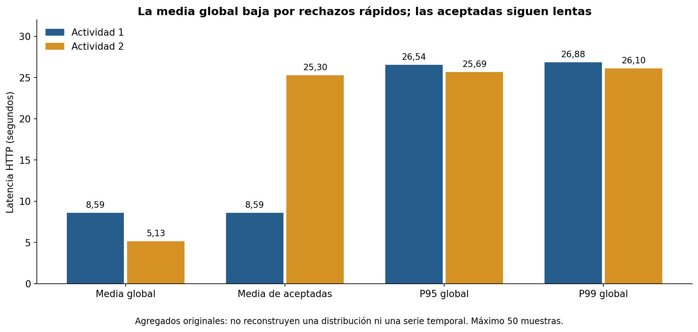
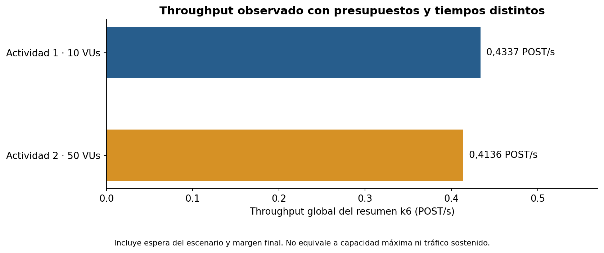

# Pruebas de Carga y Análisis de Rendimiento con Grafana k6

Informe técnico preparado el 16 de octubre de 2026. Autor, materia, docente y
formato académico final: pendientes de completar con datos reales.

## 1. Objetivo y alcance

Evaluar el comportamiento de POST /notifications/send en el flujo API Gateway →
Lambda Spring Boot → SNS → SQS → Lambda consumidora → SES Simulator, manteniendo
la cuota regional de 10 ejecuciones simultáneas y sin ampliarla.
Los scripts usaron JWT por variable de entorno y el destinatario público del
simulador. No se incluyen credenciales, endpoints reales ni cuerpos de solicitudes.

## 2. Procedencia y método

Los únicos ensayos comparados son los JSON originales de las actividades 1 y 2.
Las verificaciones individuales se conservan como antecedentes separados.
El [manifiesto SHA-256](../evidencias/originales/manifest-sha256.json) documenta
integridad y rutas. La [comparativa JSON](../evidencias/derivadas/comparativa.json)
separa configuración, mediciones, cálculos derivados y confirmaciones del usuario.

| Ensayo | VUs configurados | Duración configurada | Presupuesto |
| --- | ---: | --- | --- |
| Actividad 1 | 10 | 1 minuto | Máximo 3 POST/VU, 30 totales |
| Actividad 2, escenario 1 | 50 | 2 minutos | Máximo 1 POST/VU, 50 totales |

Ambos fueron ensayos controlados, no carga sostenida. La duración configurada no
es la duración de tráfico continuo. A2 generó una ráfaga al comienzo y luego
esperó. No es una comparación que aísle solo el número de VUs.

## 3. Resultados reales de actividades 1 y 2

| Actividad | POST | Aceptadas | Fallidas | Errores | POST/s | Media ms | Mín. ms | Máx. ms | P95 ms | P99 ms | Media aceptadas ms |
| --- | --- | --- | --- | --- | --- | --- | --- | --- | --- | --- | --- |
| Actividad 1 | 30 | 30 | 0 | 0,00 % | 0,4337 | 8 587,79 | 94,54 | 26 885,33 | 26 538,44 | 26 876,78 | 8 587,79 |
| Actividad 2 · 50 VUs | 50 | 10 | 40 | 80,00 % | 0,4136 | 5 127,91 | 75,15 | 26 459,00 | 25 687,66 | 26 104,94 | 25 295,21 |

Fuentes: [A1](../evidencias/actividad1-20261016-005817.json) y
[A2](../evidencias/actividad2-50vus-20261016-014407.json).
Todas las latencias de la tabla son milisegundos. Throughput es el valor global
del resumen, incluidos fallos y tiempo de espera; no representa capacidad máxima.

La Actividad 1 terminó con 30 checks HTTP 202 correctos y cero errores. La
Actividad 2 tuvo 10 checks correctos y 40 fallidos. El usuario confirmó actividad
de SNS/SQS/consumidor/SES en CloudWatch; aún faltan las exportaciones o capturas
para adjuntarlas como evidencia independiente de los resúmenes.

La caída de la media global en A2 no es una mejora del servicio. Las respuestas
aceptadas promediaron 25 295,21 ms. La media del grupo fallido, calculada por
diferencia entre agregados, fue **86,09 ms**. No es una serie
de muestras individuales y no permite asignar códigos ni tiempos a cada fallo.
P95/P99 se informan como descriptivos, con una muestra pequeña y controles distintos.

El agregado `vus` de A1 contiene mínimo 2, máximo 10 y último valor 2. Sin serie
temporal no puede ubicarse la bajada respecto del minuto activo o del margen
final. La configuración de 10 VUs se documenta como configuración y el máximo
observado como medición; el resumen no prueba una serie constante por sí solo.

## 4. Cuello de botella y evidencia AWS

El usuario confirmó una cuota regional de 10, un pico de 40 throttles y máximo
de concurrencia de 10 en la prueba de 50 VUs. Esta confirmación respalda rechazo
por agotamiento de concurrencia como causa operativa del episodio. Se registra
como **confirmación del usuario en CloudWatch**, no como dato extraído de k6 ni
como una nueva consulta AWS realizada al preparar el informe.

Los arranques lentos de Spring Boot ocupan entornos durante más tiempo y pueden
agravar el problema. Las funciones comparten la cuota regional; no debe asignarse
todo el presupuesto al backend olvidando al consumidor. Terraform no declara
concurrencia reservada/provisionada que sustituya esa cuota regional.

Los códigos HTTP exactos de las 40 fallidas siguen desconocidos. No se inventan
500 ni 429. Un 202 confirma aceptación en SNS, no entrega final de SES.

## 5. Actividad 2: escenarios restantes

| VUs | Duración configurada | Estado | Solicitudes/latencias reales |
| ---: | --- | --- | --- |
| 100 | 2 minutos | Pendiente y bloqueado por cuota | No medidas |
| 250 | 2 minutos | Pendiente y bloqueado por cuota | No medidas |
| 500 | 2 minutos | Pendiente y bloqueado por cuota | No medidas |

Los [scripts pendientes](../pendientes/README.md) tienen bloqueo incondicional
en inicialización y antes de HTTP. No existe variable de entorno para activarlos.
No se ejecutaron, no tienen archivos de resultados y no se grafican como ceros.

## 6. Actividad 4: degradación observada

Se presenta [el análisis de la ráfaga de 50 VUs](ACTIVIDAD4-DEGRADACION.md).
**No se realizó una prueba de estrés incremental completa.** Solo puede afirmarse
degradación y rechazo bajo la configuración observada; no un punto de ruptura
intrínseco ni capacidad estimada para 100/250/500 VUs.

## 7. Actividad 5: recuperación histórica

La [guía de recuperación](ACTIVIDAD5-RECUPERACION.md) define datos y criterio de
estabilidad propuesto. El tiempo real queda **pendiente** por falta de timestamps
y series SQS/Lambda antes/después. No equivale a 120 s de k6, 180 s de visibilidad
SQS, ni al tiempo HTTP de una respuesta. No se generó una curva de recuperación.

## 8. Mejoras propuestas, sin ampliar la cuota

Planificar la concurrencia efectiva y distribuir intentos por debajo de la cuota,
con margen para consumidor y otras funciones. Revisar inicialización asíncrona
del adaptador, medir inicio JPA/Neon y diferir clientes no usados por esta ruta.
Conservar inicialmente la validación de esquema y el pool pequeño; no aumentar
conexiones a ciegas. Separar frío/caliente con registros, mantener presupuestos
de POST y usar el simulador. El registro por estado quedó preparado en el script
de 50 VUs, pero no se ejecutó otra prueba para obtenerlo.

No se cambió el backend, Terraform ni AWS. No se recomienda resolver el problema
con timeouts mayores o reintentos automáticos que puedan duplicar notificaciones.

## 9. Pendientes de la entrega

Adjuntar cuota/throttles/concurrencia de CloudWatch, evidencia asíncrona revisada,
ventanas exactas y series históricas para recuperación. Recuperar los códigos
de error solo si existían logs/consola; si no, mantenerlos desconocidos. Completar
datos académicos, URL del repositorio y requisitos de la rúbrica. Si se exige
Actividad 3, falta su enunciado; no se inventó una actividad no solicitada.
La [guía GitHub](../../docs/ENTREGA-GITHUB.md) describe exclusiones y revisión local.

## 10. Referencias y límites

[Métricas Lambda](https://docs.aws.amazon.com/lambda/latest/dg/monitoring-metrics-types.html),
[errores de integración](https://docs.aws.amazon.com/lambda/latest/dg/services-apigateway-errors.html),
[métricas SQS](https://docs.aws.amazon.com/AWSSimpleQueueService/latest/SQSDeveloperGuide/sqs-available-cloudwatch-metrics.html).
No hay mediciones simuladas, series reconstruidas, resultados de escenarios
pendientes ni una estimación inventada de recuperación. El informe se reproduce
localmente con `herramientas/generar-informe.py`, sin k6 ni conexiones AWS.
